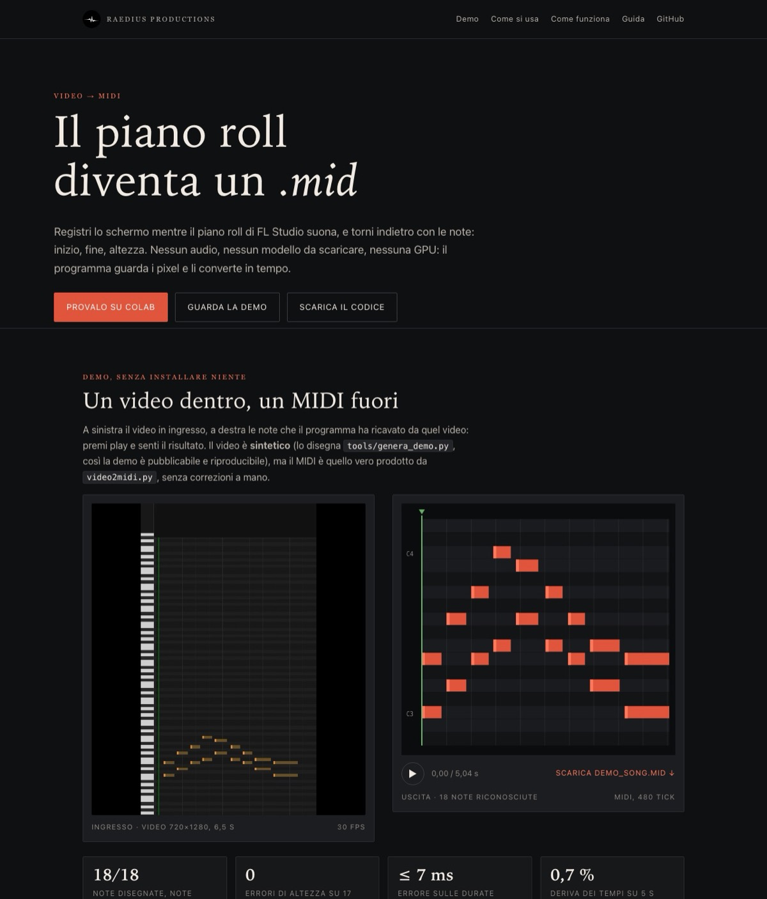

# Video → MIDI

[](https://colab.research.google.com/github/Alessandro1040/piano-roll-to-midi/blob/main/colab/piano_roll_to_midi.ipynb)
[](https://alessandro1040.github.io/piano-roll-to-midi/)
[](LICENSE)

Da una **registrazione dello schermo del piano roll di FL Studio** a un file **`.mid`**:
le note che si vedono disegnate diventano note MIDI vere, con inizio, fine e altezza.

Nessun audio, nessun modello da scaricare, nessuna GPU: è visione artificiale
classica (OpenCV + numpy) — la tastiera dà l'altezza, la testina dà il tempo.

```
video.mp4  ──►  tastiera + griglia dei semitoni  ──►  altezza di ogni nota
                testina del playhead             ──►  T = t + (x − xp)/ppt
                                                            │
                                            note_on / note_off  ──►  video.mid
```

[](https://alessandro1040.github.io/piano-roll-to-midi/)

---

## Usarlo in 30 secondi (senza installare niente)

1. Apri il notebook → [](https://colab.research.google.com/github/Alessandro1040/piano-roll-to-midi/blob/main/colab/piano_roll_to_midi.ipynb)
2. Menu **Runtime → Esegui tutto**.
3. Quando compare **Scegli file**, carica il tuo video del piano roll.
4. In fondo trovi il link per **scaricare il `.mid`**.

Serve solo un account Google: il video resta nella tua sessione Colab.

## Usarlo sul tuo computer, col sito

```bash
git clone https://github.com/Alessandro1040/piano-roll-to-midi
cd piano-roll-to-midi

python3 -m venv .venv
source .venv/bin/activate          # Windows: .venv\Scripts\activate.bat
pip install -r requirements.txt

python3 web_video2midi.py          # → http://127.0.0.1:7864
```

Apri <http://127.0.0.1:7864>, trascina il video, scegli BPM e ottava, premi
**Converti** e scarica il `.mid`. C'è anche un player: ascolti il risultato e vedi
il piano roll ricostruito prima di scaricare.

> **`127.0.0.1` vuol dire "questo computer".** Il sito non è online: ognuno avvia il
> proprio. Non puoi aprire il sito di un altro dal tuo browser — per quello c'è il
> notebook Colab.

Senza terminale: doppio clic su `avvia_midi.command` (macOS) o `avvia_midi.bat`
(Windows).

## Usarlo senza sito, una riga

```bash
python3 video2midi.py video.mp4                    # scrive video.mid
python3 video2midi.py video.mp4 --bpm 140 --ottava 4 --debug controllo
```

| opzione | cosa fa |
| --- | --- |
| `-o, --out` | nome del file `.mid` (default: accanto al video) |
| `--bpm` | BPM scritto nel file (default 120; cambia solo la griglia temporale) |
| `--ottava` | ottava FL della riga più in basso, se le etichette OCR non si leggono |
| `--debug` | cartella per le immagini di controllo (righe, zone, etichette) |
| `-q, --quiet` | niente log |

## Requisiti

* **Python 3.9+** (provato con 3.14).
* `opencv-python`, `numpy`, `flask`, `mido` → sono in `requirements.txt`.
* **Tesseract OCR** *facoltativo*: legge le etichette dei tasti (`C4`, `F#3`…) per
  capire l'ottava. Senza, il programma funziona lo stesso ma va detto `--ottava`.
  `brew install tesseract` · `sudo apt install tesseract-ocr` ·
  [installer Windows](https://github.com/UB-Mannheim/tesseract/wiki).
* **ffmpeg non serve**: il video lo legge OpenCV.

## Cosa serve nel video

* una **registrazione dello schermo** del piano roll (mp4/mov/mkv/avi/webm…),
  verticale o orizzontale;
* la **testina** (playhead) visibile mentre scorre, oppure l'auto-scroll attivo;
* niente finestre sopra le note, niente zoom che cambia a metà.

Non è riconoscimento audio e non legge il progetto di FL Studio: guarda i pixel.
Se il piano roll non si vede, non c'è niente da leggere.
---

## Come funziona

| passo | misura | cosa dà |
| --- | --- | --- |
| 1 | la tastiera è la fascia chiara a sinistra; la testina parte dall'alto del roll | `kb_end` (x) e `y_top` (y) della zona utile |
| 2 | i tasti neri sono righe scure: centri arrotondati a multipli di un semitono | altezza del semitono in pixel + classe di altezza |
| 3 | etichette OCR (`C4`, `F#3`…) o `--ottava` | l'ottava assoluta |
| 4 | rampa della testina, o fase fra due frame distanti | `ppt`: pixel di schermo per secondo di musica |
| 5 | per ogni riga, pixel più chiari del fondo (testa) e appena più chiari (corpo) | inizio, fine e altezza di ogni nota |
| 6 | raggruppamento temporale (tolleranza 90 ms) | note pulite → `note_on`/`note_off` |

Il punto delicato è il tempo: **non serve conoscere il BPM del progetto**, perché
la stessa formula

```
T = t + (x − xp) / ppt
```

vale sia quando la testina scorre sulla griglia ferma, sia quando è la griglia a
scorrere sotto una testina ferma (auto-scroll). Il BPM interviene solo quando si
scrive il file, per dare una griglia comoda da modificare in FL.

## Demo

La pagina [**alessandro1040.github.io/piano-roll-to-midi**](https://alessandro1040.github.io/piano-roll-to-midi/)
mostra un video in ingresso e il MIDI ricavato, con player e piano roll.

Il video della demo è **sintetico**: lo disegna `tools/genera_demo.py` (un finto
piano roll in stile FL, 18 note, 6,5 s) e viene convertito senza toccare niente:

```bash
python3 tools/genera_demo.py --out-frames /tmp/demo_frames
ffmpeg -framerate 30 -i /tmp/demo_frames/%04d.png -c:v libx264 \
       -pix_fmt yuv420p -crf 20 -movflags +faststart docs/assets/demo_video.mp4
python3 video2midi.py docs/assets/demo_video.mp4 -o docs/assets/demo_song.mid --ottava 3
python3 tools/esporta_demo.py docs/assets/demo_song.mid   # JSON + anteprima audio
```

Risultato su quel video: **18 note su 18**, tutti i 17 intervalli corretti, durate
entro 7 ms, deriva dei tempi 0,7 % (≈35 ms su 5 s).

## File

```
video2midi.py        il convertitore (CLI)
web_video2midi.py    il sito locale Flask: drag & drop, log, player, piano roll
requirements.txt     opencv-python, numpy, flask, mido
avvia_midi.command   doppio clic e parte il sito (macOS)
avvia_midi.bat       doppio clic e parte il sito (Windows)
logo-raedius.jpg     logo della pagina
ISTRUZIONI.md        istruzioni lunghe (installazione, errori, consigli)
docs/                pagina demo (GitHub Pages) + guida in HTML
colab/               notebook "carica il video, scarica il MIDI"
tools/               generatore della demo sintetica + esportatore asset
```

## Limiti noti

* Il MIDI è un **singolo canale** (`note_on`/`note_off` a velocity fissa): non
  ricostruisce velocity, articolazioni o più tracce.
* Serve un minimo di movimento: **testina ferma e griglia ferma = errore**
  ("non capisco come scorre il tempo").
* Le note che escono dal bordo destro non hanno una fine certa: vengono chiuse
  all'ultima osservazione.
* Nelle registrazioni FL verticali le ottave sono quelle di FL: `F4` di FL diventa
  `F3` MIDI (convenzione di FL, non un errore) — controlla con `--ottava` o con le
  etichette OCR.
* Il BPM del progetto non viene stimato.

## Licenza

MIT — vedi [LICENSE](LICENSE). Fanne quello che vuoi, anche commercialmente.

---

<sub>Raedius Productions · [guida completa in HTML](docs/guida.html) · [ISTRUZIONI.md](ISTRUZIONI.md)</sub>

